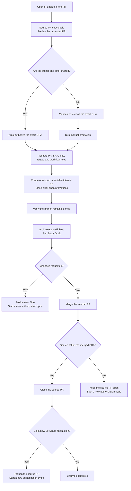

# Fork pull request promotion

## Summary

- Promotes an exact, reviewed fork commit into an immutable same-repository
  branch and pull request where credentialed Black Duck checks can run safely.
- Automatically promotes revisions when both the contributor and triggering
  user are trusted; all other revisions require one explicit maintainer
  approval.
- Keeps the original fork pull request as the canonical discussion thread and
  closes it only after its matching internal pull request merges.
- Uses SHA pinning, App-authenticated lifecycle markers, and event-driven
  reconciliation to protect against stale revisions, spoofed comments, and
  concurrent updates.

## Process flow

Fork pull requests cannot access the Black Duck credentials stored in `arm/mcp`.
The `Manage reviewed fork pull request` workflow copies an exact fork revision
to a SHA-addressed branch in `arm/mcp` and opens an internal pull request where
the normal credentialed checks can run.

## Promotion paths

- A pull request authored by a user with effective `write`, `maintain`, or
  `admin` access to `arm/mcp` is promoted automatically to
  `trusted-fork-<github-username>/pr-<number>-<sha>`.
- All other forks require a maintainer to run the workflow manually with the
  pull request number and the full reviewed head SHA. These revisions are
  promoted to `external-contributions/pr-<number>-<sha>`.

Manual promotion is also available when automatic promotion declines a
trusted author's revision because the event was triggered by a user without
write-level access. The maintainer's explicit review authorizes that exact SHA.

Each value above is used for both the SHA-addressed internal branch and the
internal pull request title. The required Black Duck check verifies that the
branch head still matches the SHA encoded in its name before checking out code
or exposing credentials. Configure the stable
`CI Black Duck security scan / Black Duck security scan` context as a required
check for `main`. GitHub's **Update branch** operation and manual branch updates
deliberately invalidate the check; do not merge or update a promoted branch
that fails it.

The workflow rejects draft pull requests, stale SHAs, closed pull requests,
non-fork pull requests, pull requests that do not target `arm/mcp:main`, and
changes to files under `.github/workflows/` (including renames and deletions).
Workflow changes from forks must be recreated by a maintainer on a trusted
internal branch and reviewed through that separate path. Promotion also fails
closed when GitHub's changed-file listing reaches its 3,000-file limit; split
such a contribution into smaller pull requests. The source head is revalidated
after file inspection so a concurrent update cannot promote the earlier SHA
using the newer revision's file list.
For automatic promotion, the user whose event opened or updated the pull
request must also have write-level access; an untrusted user cannot update a
trusted author's fork branch and cause an automatic promotion.
Updating a fork produces a new SHA-addressed promotion branch and pull request.
If an internal pull request was closed without merging, promoting the same SHA
reopens it. A merged internal pull request remains closed. After a replacement
internal pull request is created and linked, older open and unmerged internal
pull requests for the same source pull request are marked as superseded and
closed.

The Black Duck check intentionally fails on the original fork pull request.
The source pull request remains open as the canonical discussion thread after
promotion; review and merge only the linked internal pull request. If changes
are requested, the contributor pushes them to the original fork branch. The new
head SHA must be authorized and promoted into a replacement internal pull
request before credentialed checks run for that revision.

Same-repository pull requests use one hardened Black Duck scan path. Normal
internal branches and `trusted-fork-` promotions run automatically; this
accepts the credential-exposure risk for contributors with effective `write`,
`maintain`, or `admin` access. For other contributors, a maintainer's manual
promotion of the exact reviewed SHA is the single approval. After promotion
creates the SHA-addressed `external-contributions/` branch, its Black Duck scan
starts automatically. The scan's pin guard rejects either type of promoted
branch if its head no longer matches the approved SHA.

The scan checks out the exact pull request head and creates a source ZIP from
the raw contents of every tracked Git blob without running repository code.
The inline exporter runs Python in isolated mode (`python3 -I`) and reads Git
objects with `git ls-tree` and `git cat-file`; it cannot import modules or site
customizations from the contributor checkout. It does not use `git archive`,
checkout filters, or contributor-controlled `.gitattributes`, so
`export-ignore` and `export-subst` cannot omit or rewrite reviewed files.
Unsupported tree paths fail the job rather than producing a partial scan. The
scan job has read-only repository permissions and receives no token capable of
commenting on or changing the pull request.

The same job exposes the stable `Black Duck security scan` required-check
outcome: it fails before checkout on an original fork PR, while a
same-repository PR continues through archive creation and the credentialed
scan. The `Main Push and Scheduled full source scan` job is the separate full
scan for `main` pushes and scheduled runs; it is not a pull-request merge gate.

When an internal pull request merges, the workflow closes the source pull
request only if its current head still matches the merged, reviewed SHA. If the
contributor has already pushed another revision, the source pull request remains
open and that newer SHA requires separate authorization and promotion. The
finalization path re-reads the source after closing and restores it to open if a
concurrent update won the close race. If an update arrives after the final read,
its trusted `pull_request_target` `synchronize` run verifies the recorded merged
internal pull request, reopens the source, and then applies the normal
authorization rules to the new SHA. Trusted authors and triggering users are
promoted automatically; all other revisions remain open until a maintainer
manually authorizes that exact SHA.

Promotion also records the fork's immutable GitHub repository ID with the
source pull request number and reviewed SHA in the internal pull request. If the
contributor later deletes the fork and GitHub returns `head.repo: null`,
finalization uses that stored identity and the still-reported head SHA to close
and comment on the source pull request safely. Older promotions without the
stored repository ID continue to finalize while the fork exists, but fail
closed if its identity is no longer available.

## GitHub App configuration

Created and installed a dedicated GitHub App on `arm/mcp` with these repository
permissions:

- Contents: read and write
- Metadata: read
- Pull requests: read and write

Do not grant the App Workflows permission. The promotion helper rejects
workflow-file changes before creating an internal ref, and the missing
permission provides a second enforcement layer at the GitHub API boundary.

Configured the repository with:

- Variable `GH_APP_ID`: the App client ID
- Secret `GH_APP_TOKEN`: one of the App private keys

The App token is used so the internal PR triggers normal `pull_request`
workflows without the approval-required behavior applied to PRs created by the
built-in `GITHUB_TOKEN`. The workflow also passes the App slug reported by the
token action to the lifecycle helper. Promotion, finalization, and
reconciliation markers are authoritative only when GitHub reports the comment's
`performed_via_github_app.slug` as that configured App; contributor-authored
lookalike markers are ignored.

## Actions policy

Automatic promotion uses `pull_request_target`, but the workflow checks out
only `main` and treats the fork revision strictly as an opaque Git object. It
never checks out or executes fork content. The organization Actions policy must
allow `pull_request_target` for this workflow, including the `closed` event used
to finalize a merged internal pull request, and must allow `workflow_dispatch`
for explicit maintainer promotion. External contributors use that manual path
after the maintainer reviews their exact head SHA.
